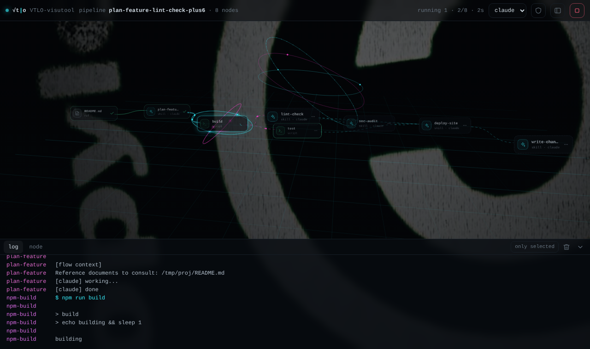

# VTLO-visutool  (`/flow`)  ·  [English](README.md)

**Installation rapide (une ligne)**

    git clone https://github.com/VTLO/VTLO-visutool && sh VTLO-visutool/install-agy.sh        # agy
    git clone https://github.com/VTLO/VTLO-visutool && node VTLO-visutool/flow.mjs install    # claude + gemini + agy (détectés)
    curl -fsSL https://raw.githubusercontent.com/VTLO/VTLO-visutool/main/install-agy.sh | sh  # sans clone (dépôt public)

Transforme n'importe quel workflow, pipeline ou groupe de skills / commandes / scripts / références en appli web 3D cliquable.
Chaque clic sur un nœud lance la **vraie commande** dans ton CLI (Claude Code, Gemini CLI, Antigravity `agy`).
Zéro dépendance — Node ≥ 18. Linux, macOS, Termux.

## Utilisation simple
> Interface et messages **100 % en français par défaut** (anglais : bouton FR/EN ou `FLOW_LANG=en`). Au premier lancement, un **guide en 3 étapes** s'affiche (bouton **Aide** pour le rouvrir) ; les boutons sont explicites (« Créer mon enchaînement », « Tout lancer ») et le catalogue se coche comme une liste.
Dans le CLI, tape `/flow` : il liste ce qu'il a trouvé et te demande quels skills / scripts / références (ou quel pipeline existant) utiliser.
- `/flow release` → ouvre un pipeline existant (`.flow/pipelines/*.json` ou workflow agy `.md`, affiché tel quel)
- `/flow plan-feature, lint-check, npm:test, deploy-site` → pipeline auto-orchestré (plan → build → vérif → livraison → rapport, en parallèle au sein d'une étape ; `after:` dans le SKILL.md ajoute une dépendance)
- Dis « en séquence » ou « en parallèle » pour changer le câblage.
- **Étape obligatoire** : quand tu choisis des éléments, rien n'est construit directement. Un **plan est proposé** (étapes, groupes parallèles, raison de chaque position) et **tu dois le valider** — dans l'appli (modale : décocher une étape, changer le mode, Valider / Valider et lancer / Annuler) ou dans le chat (`flow validate`). Un pipeline existant s'ouvre tel quel, sans plan.

Depuis le terminal (plus court) :

    flow                       # ouvre l'appli, choisis dans la palette
    flow a b "npm run x"       # pipeline construit avec ces éléments
    flow go a b c              # pareil + lancement immédiat (après ta validation)
    flow plan a b c            # propose seulement le plan ; puis : flow validate [--run] [--exclude id] · flow cancel
    # --yes : valide d'avance (automatisation, à demander explicitement)
    flow install               # ajoute /flow aux CLI détectés
    flow update                # dernière version + réinstallation
    flow url                   # réaffiche l'URL d'accès (si la page affiche 403)

Dans l'appli : **clic** sur un nœud = le lancer (re-clic = l'arrêter) · **maj+clic** = lancer à partir de là · **▶** = tout lancer · **⚡** (palette) = construire **et** lancer en un clic · **i** = modifier commande / prompt / dépendances · glisser = orbite, maj+glisser = déplacer, molette = zoom · `/` = recherche · bouton **FR/EN** = langue (auto selon le navigateur ; CLI : `--lang fr|en` ou `$LANG`).

## Exécution des nœuds
| nœud | exécute |
|---|---|
| script | `sh -c "<commande>"` dans le dossier du projet |
| skill | `<cli> -p "Utilise le skill x …"` + contexte (fichiers de référence, sorties des étapes amont) |
| commande | `<cli> -p "/x args"` (Gemini : TOML développé localement) |
| prompt | `<cli> -p "<texte>"` |
| réf | contexte pour les nœuds suivants ; un clic l'affiche |

Les sorties sont dans `.flow/runs/<horodatage>/`. `agy -p` peut se bloquer sans TTY : agy tourne donc dans un pseudo-terminal (`script`).
En headless, les CLI refusent d'éditer sans approbation : le bouton bouclier (ou `--approve`) ajoute le flag du CLI (`--permission-mode acceptEdits` / `--yolo` / `--dangerously-skip-permissions`). Désactivé par défaut.

## Sécurité
Serveur sur 127.0.0.1 uniquement, jeton d'accès par lancement (`?t=` dans l'URL, envoyé en en-tête par l'appli — pas de cookie requis), contrôle Host/Origin.
Les scripts à l'allure destructrice (rm -r, sudo, git push …) demandent une confirmation.
