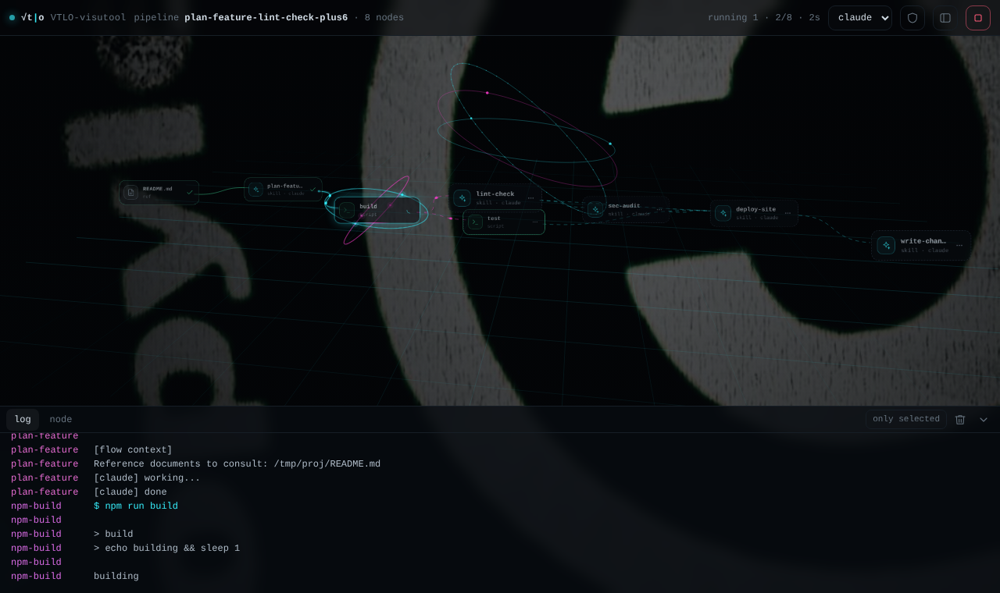

# VTLO-visutool  (`/flow`)

Turns any workflow, pipeline or group of skills / commands / scripts / references into a clickable 3D web app.
Every node click runs the **real command** through your CLI (Claude Code, Gemini CLI, Antigravity `agy`).
Zero dependencies — Node ≥ 18. Works on Linux, macOS, Termux.

## Install
    sh install-agy.sh    # one-shot for Antigravity CLI (agy): checks Node/pty helper, installs engine + /flow skill & workflow (Termux ok)

Or by hand:
    node flow.mjs install                 # user scope: /flow in claude + gemini + agy
    node flow.mjs install --host agy      # one CLI only
    node flow.mjs install --scope project # into ./.claude ./.gemini ./.agents

Files written: `~/.flow/{flow.mjs,ui.html,bg.jpg}`, `~/.claude/commands/flow.md`,
`~/.gemini/commands/flow.toml`, agy skill `~/.gemini/antigravity/skills/flow/SKILL.md` + workflow `global_workflows/flow.md`.

## Use
Type `/flow` in the CLI. It lists what it found and asks which skills / scripts / refs (or which existing pipeline) you want.
- `/flow release` → opens an existing pipeline (native `.flow/pipelines/*.json` or an agy workflow `.md`, shown as defined)
- `/flow plan-feature, lint-check, npm:test, deploy-site` → auto-orchestrated (plan → build → verify → ship → report, parallel inside a stage; `after:` in SKILL.md frontmatter adds explicit edges)
- `/flow` then "in sequence" / "in parallel" changes the wiring.

In the app: **click** a node = run it (click again = stop) · **shift-click** = run from there · **▶** = run all · **i** = edit command/prompt/dependencies · drag = orbit, shift-drag = pan, wheel = zoom · `/` = search.
Palette: tick items → wand = new pipeline, + = append. Free input accepts shell commands, `?agent prompt`, URLs, paths.

## CLI
    flow url   # reprint/reopen the access URL if you lost it (403 page)
    flow list [--compact|--json|--desc]   flow open [--load N|--items a,b|--import wf.md] [--mode auto|seq|par]
    flow run  [NAME|--items …] [--approve] (headless)   flow status | stop | doctor | uninstall

## How nodes execute
| node | runs |
|---|---|
| script | `sh -c "<command>"` in the project dir |
| skill | `<cli> -p "Use the \"x\" skill …"` + context (reference files, upstream output files) |
| command | `<cli> -p "/x args"` (Gemini: TOML expanded locally) |
| prompt | `<cli> -p "<text>"` |
| ref | context for downstream nodes; click previews it |
Outputs land in `.flow/runs/<stamp>/`. `agy -p` can hang without a TTY, so agy runs inside a pty (`script`).
Headless runs soft-deny edits unless approved: the shield button (or `--approve`) adds the CLI's approve flag
(`--permission-mode acceptEdits` / `--yolo` / `--dangerously-skip-permissions`). Off by default.

## Config (`~/.flow/config.json` or `.flow/config.json`)
    { "concurrency": 3, "timeoutSec": 900,
      "hosts": { "agy": { "bin": "agy", "args": ["-p","{prompt}"], "pty": "auto", "extra": ["--model","…"] } } }

## Security
Server binds 127.0.0.1 only, per-launch access token (`?t=` in the URL, sent as a header by the app — no cookie needed), Host/Origin checks, custom header on POST.
Destructive-looking scripts (rm -r, sudo, git push …) ask for confirmation in the UI.
